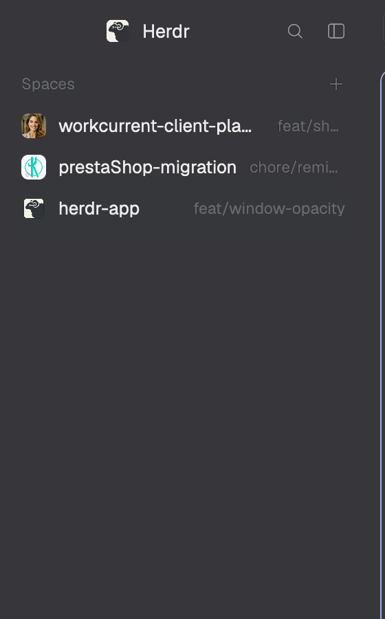

# Space avatars

Herdr's Spaces sidebar, unchanged, except that each space's colored letter
tile can be an image. Right-click a space and pick **Set icon…** to give that
one space its own picture; spaces without one fall back to an image named
after their repo in `~/.config/herdr-app/space-icons/`, and then to the usual
letter tile.

## What you see

- The same sidebar list as Herdr's shipped `spaces` mod (cloned from Herdr
  0.1.11): a 31px header with "Spaces" (11.5px, `theme().dim`) and a 26px `+`
  button; rows 30px high (28px for a worktree nested under its repo), 8px
  rounded, `theme().selected` behind the active space, `theme().hover` on hover;
  machine headers (26px) once a space on another computer is known.
- Before each top-level space's name: an 18×18px avatar, 5px rounded. Which one:
  1. the image picked for that space with **Set icon…**;
  2. else `space-icons/<repo>.<png|jpg|jpeg|gif|webp|svg>` (the repo's name,
     case-insensitive; a folder that isn't a repo goes by its folder name; when a
     repo has several, the first type in that list wins);
  3. else Herdr's tile: the space's color from `shared("space.colors")`
     (`ansi6` → `#22a99a`, `ansi3` → `#e3814f`, `ansi4` → `#5b8def`,
     `ansi5` → `#8b7cf6`, `ansi2` → `#3fae6a`, `ansi1` → `#d9649a`) with its first
     letter, bold 10.5px white.
- Worktree rows keep the branch glyph instead of an avatar. The rail (sidebar
  narrower than 160px) shows numbers and status dots, as the shipped mod does.
- The space menu: a popup (200px wide) styled like Herdr's: 31px items with a
  14px icon, the label, and the bound key on the right; a 1px divider before
  Close. Items: Rename, New worktree, Open worktree (in a repo), Remove worktree
  (in a worktree), **Set icon…** (spaces on this computer), **Remove icon** (when
  the space has its own), Close.
- The icon dialog (460×250, centered): title "Icon for <space>", an "Image file"
  input (placeholder `~/Pictures/icon.png`), a hint line "PNG, JPG, GIF, WebP or
  SVG. Paste a path or drop a file here." that turns `theme().blocked` with the
  error when something is wrong, and Cancel / Set icon buttons.

## How it behaves

- Click a space to switch to it, drag to reorder, right-click for the menu,
  click a machine header to fold it: all as Herdr's `spaces`. Agent status is
  not shown here (the agents list has it), only in the rail's dots: `●` in
  `blocked` or `done` color when a space needs you, `·` otherwise.
- Menu: ↑/↓ move, Enter runs, Esc closes; Rename, the worktree items and Close
  do exactly what Herdr's menu does.
- **Set icon…** opens the dialog. Type, paste or drop an image. The path may
  start with `~`, be wrapped in quotes, start with `file://` (URL-decoded), or
  have terminal-escaped spaces (`My\ Icon.png`). Enter or Set icon checks that it
  is a png/jpg/jpeg/gif/webp/svg and that the file exists, copies it to
  `~/.config/herdr-app/data/space-avatars/<space id>-<8 hex>.<type>` and the
  sidebar shows it at once. Each pick gets a new file name, so changing the
  image always redraws; the previous copy is deleted. Esc or Cancel closes
  without changes.
- **Remove icon** forgets the space's image and deletes its copy; the space
  goes back to its repo's `space-icons/` image or the letter tile.
- Adding, renaming or deleting files in `space-icons/` updates the sidebar
  while it runs (the folder is watched).

## Built from

- One mod, `mods/space-avatars/` (`mod.json`: `{ "place": "none", "title":
  "Space avatars", "cloned_from": { "name": "spaces", "version": "0.1.11" } }`).
  Use it by setting the `spaces` block's `content.mod` to `space-avatars` in a
  layout.
- `main.js`: Herdr's `spaces/main.js` with four changes: the avatar comes from
  `resolveIcon(...)`, the `space-icons/` listing goes through
  `parseIconListing`, right-click opens `openOverlay({ mod: "space-avatars",
  kind: "popup", width: 200, height: 300, props: { view: "menu", space } })`
  instead of the shipped `menu`, and the default export picks its view from
  `props.view`: none → the sidebar, `"menu"` → `SpaceMenu` (`menu.js`), `"pick"`
  → `PickIcon` (`pick.js`).
- `menu.js`: the shipped `menu` mod's space items plus the two icon items.
  Worktree items open the shipped `worktree` mod as a dialog (same props and
  sizes as Herdr's menu); Set icon opens this mod as a dialog with props
  `{ view: "pick", space }`.
- `pick.js`: a text dialog modeled on the shipped `prompt` mod (`InputState`,
  `Input`), plus `.on_drop` for files dragged in.
- `files.js`: `setIcon` / `removeIcon`. Copies with `exec("cp", ["--", src,
  dest])` after `mkdir -p` and `test -f` (Windows: `cmd /c mkdir`, `cmd /c copy
  /Y`, `cmd /c del /q`); deletes only files directly in `data/space-avatars/`.
- `avatars.js`: pure helpers, no `herdr` import: `normalizePath`, `iconType`,
  `hashText` (FNV-1a), `avatarFile`, `parseIconListing`, `resolveIcon`,
  `ownsFile`, `withIcon` / `withoutIcon`. Tested in `test/avatars.test.js` with
  `bun test`.
- State: `shared("space-avatars.icons")` = `{ [space id]: "data/space-avatars/…" }`.
- `herdr` functions: `spaces`, `machines`, `panes`, `run` (`space.select`,
  `space.move`, `space.new`, `space.rename`, `space.close`), `openOverlay`,
  `closeOverlay`, `props`, `exec` (`git`, `ls`, `cp`, `mkdir`, `test`, `rm`),
  `hc` (`machine ls --json`), `theme`, `keys`, `shared`, `setShared`,
  `watchFolder`, `window`, `layout`, `appHome`, `home`.
- Art: `image.svg` (the menu's icon items), Herdr's
  `mods/workspace-chrome/*.svg` for everything else.

## Watch out

- It runs programs (`git`, `ls`, `cp`, `mkdir`, `test`, `rm`; `cmd` on Windows),
  reads the image you point it at (anywhere on this computer) and writes only
  under `~/.config/herdr-app/data/space-avatars/` and the shared key
  `space-avatars.icons`. No network.
- The shipped `menu` mod's items are fixed in its code, so this mod draws its
  own copy of the space menu: a Herdr release that changes that menu won't
  reach it. The same for the sidebar itself (a copy of 0.1.11's `spaces`).
- The shipped `prompt` mod can't be used for the path: it runs `<command>` with
  the typed text as `name`, and a mod's `<mod>.<command>` reaches
  `nextCommand()` as a bare string, without arguments.
- `image()` only reads paths relative to the Herdr home, so the picture is
  copied in; `fs.writeFile` with a `Uint8Array` has written 0-byte files, so the
  copy goes through `cp`.
- The mod's name `space-avatars` is written in `files.js` (`MOD`), used for its
  own overlays and `mods/space-avatars/image.svg`: renaming the folder means
  changing it too.
- Spaces on other machines can't pick an icon (the file would be on that
  machine); they still show one already mapped to their id and their
  `space-icons/` match.
- Mappings of closed spaces stay in the shared key (and their copies on disk);
  a new space gets a new id, so they never show again.
- `herdr-app check` renders only the sidebar view; the menu and dialog are
  checked by loading a copy with `props.view` forced.
- Windows: the `cmd` copy and delete are untested, and `space-icons/` is listed
  with `ls` (as Herdr's own `spaces` does), so the folder fallback needs `ls`.

## Done when

- `bun test` passes.
- `herdr-app check ~/.config/herdr-app/mods/space-avatars` passes.
- With the layout's `spaces` block on `space-avatars`, the sidebar looks exactly
  like Herdr's before any icon is set.
- Right-click a local space: the menu shows Set icon…; pick a PNG with `~` in its
  path: the space's tile becomes that image, and a file appears in
  `data/space-avatars/`.
- Set a different image: it shows at once and the old copy is gone.
- Remove icon: the letter tile (or the repo's `space-icons/` image) is back and
  the copy is deleted.
- A path to a `.txt` file or a missing file shows the error in the dialog and
  changes nothing.
- A space on another machine has no Set icon… item.
